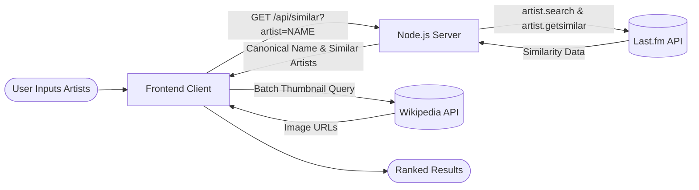

# Findiva

[](#tech-stack)
[](#tech-stack)
[](#quickstart)

Findiva is a music discovery tool that recommends new artists based on ones you already like. Enter 1 to 8 artists, and the app retrieves similar artists from Last.fm, aggregates their scores, and ranks the top recommendations with relative match percentages, artist photos, and streaming links.

## Features

- **Multiple Artist Input:** Enter between 1 and 8 seed artists.
- **Cumulative Scoring:** Similarity scores from Last.fm are summed across all input artists, so artists related to multiple seeds rank higher.
- **Typo Correction:** Resolves misspelled artist names (e.g., `Mistki` to `Mitski`) using Damerau-Levenshtein distance and Last.fm search listener counts, updating the seed labels accordingly.
- **Ranked Results:** Displays the top 10 recommended artists with relative percentage scores (scaled so the top recommendation is 100%, indicating relative affinity rather than an absolute compatibility probability) and color-coded confidence tiers (green for $\ge 90\%$, amber for $\ge 70\%$, red for $< 70\%$).
- **Streaming Search Links:** Direct search links for each recommended artist on Spotify, YouTube, and Last.fm.
- **Artist Images:** Batched thumbnail retrieval from the Wikipedia MediaWiki API, with a fallback placeholder when unavailable.
- **Multilingual Interface:** Interface translation toggle between English (`EN`), Indonesian (`ID`), and Japanese (`日本語`).
- **Server-Side API Key:** The Last.fm API key is handled entirely by the backend server, keeping credentials out of client-side code.

## How It Works



1. **Input Normalization:** Trims whitespace and removes duplicate seed entries.
2. **Typo Resolution:** The server checks candidate artist names against Last.fm's search API using Damerau-Levenshtein distance. When a close match with a higher listener count is found, the query adopts that canonical name.
3. **Similarity Retrieval:** The server queries Last.fm's `artist.getsimilar` endpoint for each seed artist using the server-side API key, returning up to 30 similar artists per query.
4. **Score Aggregation:** Seed artists (and their typos) are excluded from the candidate pool. Match values ($0.0 \le \text{match} \le 1.0$) are accumulated into a cumulative similarity score:
   $$\text{Score}(A) = \sum_{s \in \text{Seeds}} \text{match}(A, s)$$
5. **Ranking and Percentage Calculation:** The candidate pool is sorted in descending order by cumulative similarity score. The top 10 are selected, and relative match percentages are calculated against the highest-scoring candidate:
   $$\text{Percentage}(A) = \left\lfloor \frac{\text{Score}(A)}{\max(\text{Score})} \times 100 \right\rceil$$
   The top candidate is normalized to 100%. This percentage reflects relative position within the active candidate pool, not an absolute compatibility probability.
6. **Image Retrieval & Display:** Thumbnail images are fetched from Wikipedia's API in a single batched query, and results are displayed with streaming links.

### Example

Entering **Radiohead**, **Portishead**, and **Massive Attack** queries similar artists for each seed. Artists with connections to multiple seeds—such as _The Smile_ (linked to Radiohead) or _Tricky_ (linked to Portishead and Massive Attack)—accumulate higher cumulative similarity scores. The highest-scoring candidate is scaled to 100%, and remaining candidates are displayed proportionally.

---

## Limitations

- **Catalog Coverage:** Recommendations rely on Last.fm's listening data; emerging, local, or obscure artists may have fewer or less accurate similarity links.
- **Relative Metric:** Match percentages represent ranking within the current session's candidate pool, not an absolute probability of personal musical preference.
- **Seed Sensitivity:** Recommendation quality reflects the specificity of the provided seed artists; pairing distant genres produces a broader candidate pool.

---

## Tech Stack

| Component  | Technology                                                                                                                                                                             |
| ---------- | -------------------------------------------------------------------------------------------------------------------------------------------------------------------------------------- |
| Frontend   | HTML5, CSS3, Vanilla JavaScript (ES6 Modules)                                                                                                                                          |
| Typography | Plus Jakarta Sans                                                                                                                                                                      |
| Backend    | Node.js native HTTP server (`server.mjs`)                                                                                                                                              |
| APIs       | [Last.fm AudioScrobbler API](https://www.last.fm/api) (`artist.getsimilar`, `artist.search`), [Wikipedia Action API](https://www.mediawiki.org/wiki/API:Main_page) (`prop=pageimages`) |

---

## Quickstart

### Prerequisites

- [Node.js](https://nodejs.org/) v18 or newer (uses native `fetch`).

### Setup

1. **Clone the repository:**

   ```bash
   git clone https://github.com/kaelindev/findiva-artist-discovery.git
   cd findiva-artist-discovery
   ```

2. **Configure environment variables:**
   Copy `.env.example` to `.env`:

   ```bash
   cp .env.example .env
   ```

   Add your Last.fm API key to `.env`:

   ```env
   LASTFM_API_KEY=your_lastfm_api_key_here
   PORT=3000
   ```

   A free key can be created on the [Last.fm API account creation page](https://www.last.fm/api/account/create).

3. **Start the server:**
   ```bash
   npm start
   ```
   Open `http://localhost:3000` in your browser.

To verify JavaScript syntax across project files:

```bash
npm run check
```

---

## Project Structure

```
findiva/
├── index.html         # Application markup
├── style.css          # Stylesheet and responsive layout
├── app.js             # Client controller, UI events, and i18n
│
├── js/
│   ├── api.js         # Client requests to /api/similar and Wikipedia
│   └── similarity.js  # Score aggregation, ranking, and typo matching
│
├── server.mjs         # HTTP server and Last.fm API proxy
│
├── .env.example       # Example environment variables
├── .gitignore         # Git ignore rules
├── package.json       # Project scripts and metadata
└── README.md          # Project documentation
```
